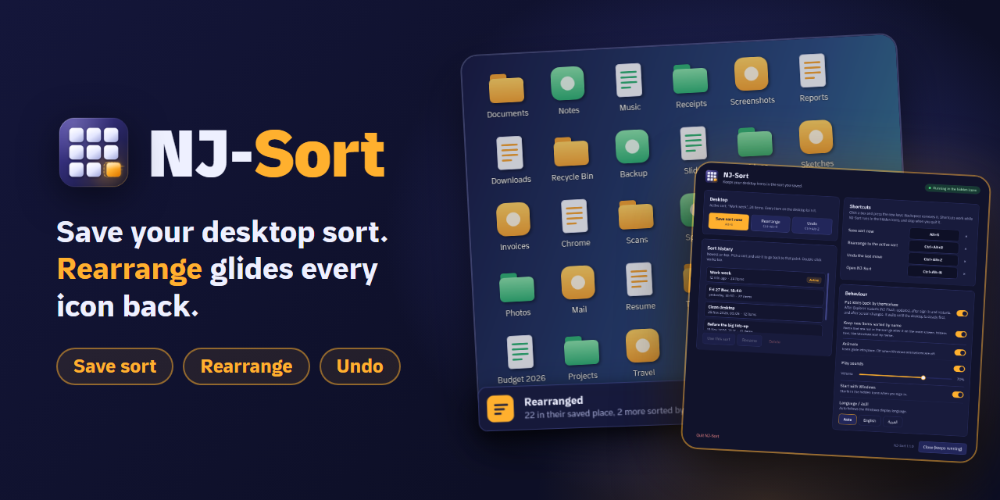
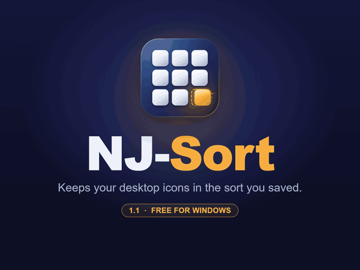
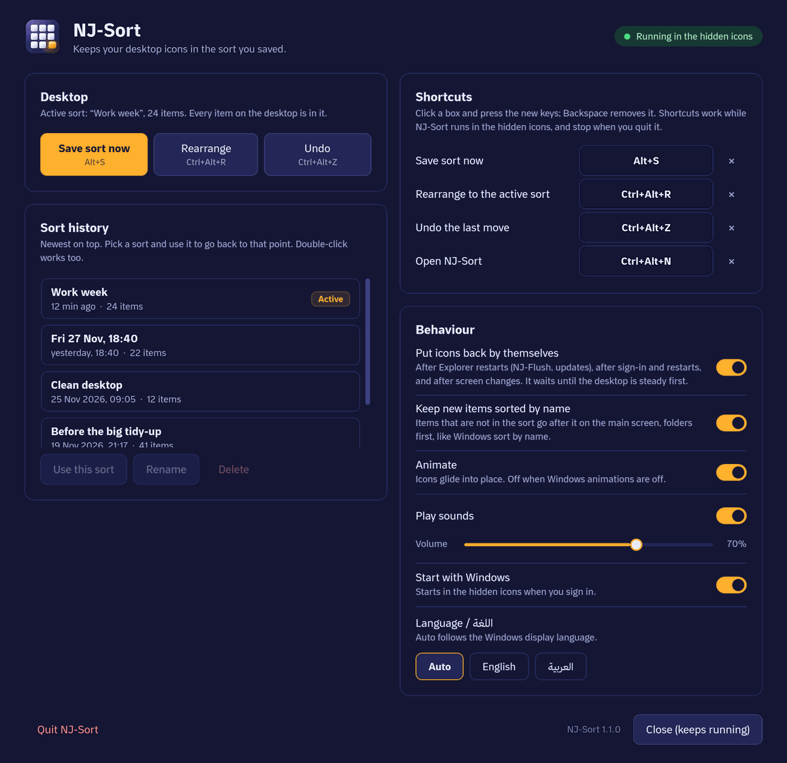
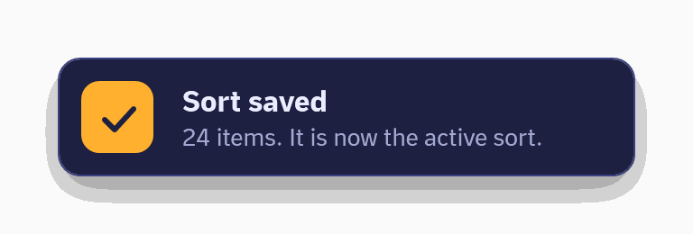
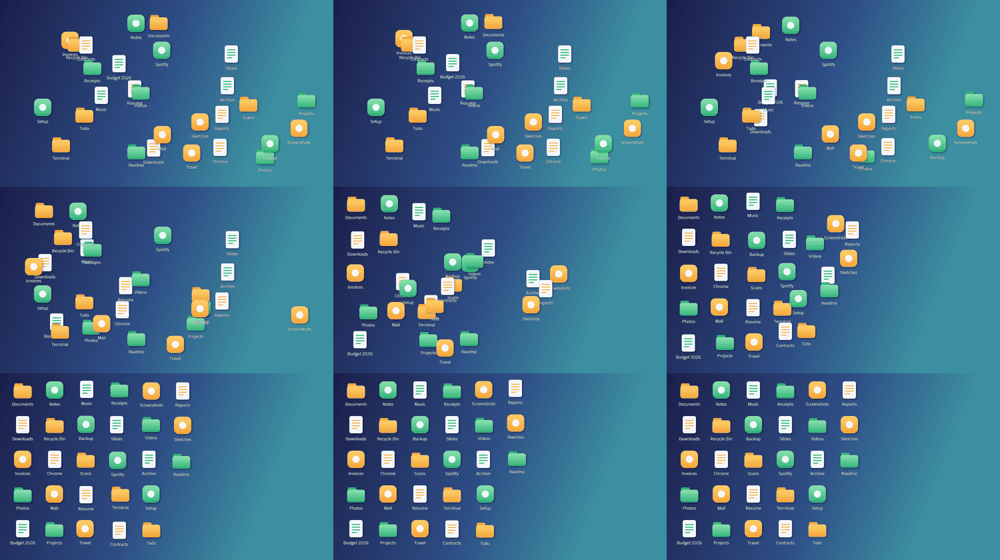

<p align="center"></p>

<p align="center"><a href="https://nj-burrito.github.io/NJ-Sort/"></a></p>

<h1 align="center">NJ-Sort</h1>

<p align="center">Keeps your Windows desktop icons in the sort you saved, even after File Explorer restarts.</p>

<p align="center"><a href="https://nj-burrito.github.io/NJ-Sort/">Website</a> · <a href="https://nj-burrito.github.io/NJ-Sort/ar/" lang="ar" dir="rtl">الموقع بالعربية</a> · <a href="https://github.com/NJ-Burrito/NJ-Sort/releases/latest">Download</a></p>

Windows forgets where your desktop icons were. After an update, a crash, a screen change or a tool that restarts File Explorer, they come back in the wrong places. NJ-Sort saves your arrangement and puts it back. It is free and open source (MIT).

- **Save sort now** saves where every icon is as a new sort in the history.
- **Rearrange** puts every icon of the active sort back in its place, and the icons glide there.
- Items that are not in the sort follow it on the main screen, sorted by name (folders first), column by column, the way Windows' own Sort by name works.

<p align="center"></p>

<p align="center"></p>

## What is new in 1.1

- **New icon and logo:** a grid of icons with one amber tile snapping into its slot.
- **Redesigned window and toasts:** a dark window and dark toast cards, with the same buttons and shortcuts as before.
- **A curved glide with a soft landing:** each icon lifts a little, travels along a gentle arc, overshoots by a few pixels and settles. The whole move takes the same time as in 1.0.
- **Real recorded sounds:** five short sounds from [Mixkit](https://mixkit.co) (free licence, credits in [sfx/CREDITS.md](sfx/CREDITS.md)) replace the synthesised ones. They stay quiet, and the volume slider still applies.
- **The whole app in Arabic:** window, toasts and tray menu, laid out right to left. A **Language** switch (Auto, English, العربية) sits in the window; Auto follows the Windows display language.
- **The source is split into `src/`**, one type per file (see [Build from source](#build-from-source)).

## Install

1. Download `NJ-Sort.exe` from the [latest release](https://github.com/NJ-Burrito/NJ-Sort/releases/latest).
2. Double-click it. NJ-Sort copies itself to `%LOCALAPPDATA%\NJ-Sort` and opens. It needs no admin rights.
3. Arrange your icons, then press **Save sort now** (Alt+S).

The program is not code-signed, so Windows SmartScreen may warn on the first run: choose **More info**, then **Run anyway**.

## Use

NJ-Sort runs in the hidden icons (the ^ next to the clock). Its shortcuts work while it runs. **Quit NJ-Sort** stops it, and the shortcuts stop with it.

| Action | Default shortcut | What it does |
|---|---|---|
| Save sort now | Alt+S | Saves every icon position as a new sort and makes it the active one. If nothing moved, it says so and saves nothing. |
| Rearrange | Ctrl+Alt+R | Puts the active sort back. Items not in it follow it, sorted by name. |
| Undo the last move | Ctrl+Alt+Z | Moves the icons back to where they were before the last rearrange. Press it again to redo. |
| Open NJ-Sort | Ctrl+Alt+N | Opens the window. A left-click on the tray icon does the same. |

<p align="center"></p>

To change a shortcut, click its box and press the new keys; Backspace removes it. A shortcut another program already uses is flagged in red.

**Sort history.** Every save is kept, newest on top. Pick one and choose **Use this sort** (or double-click it) to go back to that point. You can rename a sort, and **Delete** sends it to the Recycle Bin, so it can be restored.

| Setting | Default | What it does |
|---|---|---|
| Put icons back by themselves | on | After File Explorer restarts, after sign-in and restarts, after screen changes and after the PC wakes up |
| Keep new items sorted by name | on | A new file on the desktop takes its place among the unsorted items, in name order, after the saved ones |
| Animate | on | Icons glide into place. Off when Windows animations are off |
| Play sounds | on | Short recorded sounds for sort, save, undo, notices and errors, with a volume slider |
| Language | Auto | Auto follows the Windows display language; or choose English or العربية. The window switches at once |
| Start with Windows | off | Starts in the hidden icons when you sign in |

## Arabic

The whole app is in Arabic: the window, the toasts and the tray menu, mirrored right to left. Open the window and use **Language / اللغة**. Auto picks Arabic when Windows is set to Arabic.

<p align="center"></p>

| English | العربية |
|---|---|
| Save sort now | حفظ الترتيب الآن |
| Rearrange | إعادة الترتيب |
| Undo | تراجع |
| Sort history | سجل الترتيبات |
| Use this sort | استخدام هذا الترتيب |
| Play sounds | تشغيل الأصوات |
| Start with Windows | التشغيل مع ويندوز |
| Quit NJ-Sort | إنهاء NJ-Sort |

<p align="center"></p>

## The motion

Icons do not jump. They move in a cascade in reading order of their destination, column by column, one icon every few milliseconds. Each icon takes 0.46 s, so even a full desktop finishes in under 0.8 s. The glide is off when Windows animations are off, or when you turn off **Animate**.

<p align="center"></p>

## How it stays out of trouble

- **A saved sort is never changed by the program.** Only you save, rename or delete one.
- **File Explorer restarts are waited out.** Tools such as [NJ-Flush](https://nj-burrito.github.io/NJ-Flush/) restart Explorer, and the desktop empties for a moment. NJ-Sort sees this from the desktop window disappearing, the taskbar being recreated, or most items vanishing at once. It then waits until the item count has been steady for about three seconds and puts the sort back. Four seconds later it checks once more, in case Explorer re-applied its own positions.
- **Only the desktop is touched.** NJ-Sort moves items in the desktop's own icon view, and nothing else.
- **Align to grid is respected.** If an icon pushes a neighbour aside while it glides, the neighbour is put back at the end.
- **Auto arrange.** When Windows' Auto arrange icons is on, Windows decides the positions. NJ-Sort tells you to turn it off and moves nothing.
- **Screens.** A saved place on a monitor that is no longer connected is treated like an unsorted item and goes to the main screen.

Everything is stored in `%LOCALAPPDATA%\NJ-Sort` (or the folder named in the `NJSORT_HOME` environment variable): `sorts\` (one file per sort), `settings.ini`, `undo.tsv` and `nj-sort.log`. To remove NJ-Sort, turn off Start with Windows, quit it, and delete that folder.

**Font:** the window uses Thmanyah Sans when it is installed on the PC. It is not bundled, because its licence does not allow that; otherwise Segoe UI is used.

## Build from source

Windows with .NET Framework 4.x; no SDK, no NuGet.

```
build.cmd                     REM -> dist\NJ-Sort.exe (C# 5, csc.exe from the Framework, WPF + WinForms)
dist\NJ-Sort.exe --selftest   REM loads and lays out both windows off-screen; exit 0 = OK
```

Switches of `NJ-Sort.exe`: `--tray` (start in the hidden icons, which Start with Windows uses), `list` (print the desktop items), `--selftest`, `--render <folder>` (draw the README images from sample data), `--render-motion <folder>` (draw the icon glide on a fake desktop, off screen) and `--strings <file>` (export the English and Arabic text as a table). `NJSORT_LANG=ar|en` picks the language of a render.

| Path | Role |
|---|---|
| `src/App/` | Start-up and self-install, settings, shortcuts, sounds, and the core: watching the desktop, the actions, the tray icon |
| `src/Desktop/` | Desktop icon access (the list view in Explorer) and the animation that moves the icons |
| `src/Sorts/` | Saved sorts on disk, and the planner that decides where every icon goes |
| `src/UI/` | The main window (its XAML apart), the toast, the colours and sizes, and the off-screen renders |
| `src/Text/` | The English and Arabic string table |
| `brand/` | The logo masters (SVG) and the scripts that draw the icon and logo from them |
| `assets/` | The logo (`.png`), the icon (`.ico`) and `sfx/`, the five sounds embedded in the program |
| `make_sfx.py` | Mixes the five sounds from the Mixkit recordings; credits in `sfx/CREDITS.md` |
| `build.cmd` | Compiles `src\` and embeds the icon, logo and sounds |
| `docs/` | The website (GitHub Pages, English and Arabic) and the README images, drawn by `--render` |

## Technologies

C# 5 on .NET Framework 4. WPF draws the window and the toast, and WinForms the tray icon. Win32 calls move the icons: `LVM_GETITEMPOSITION` and `LVM_SETITEMPOSITION32` on the desktop's list view, through shared memory in Explorer. The sounds are Mixkit recordings, mixed by a Python script. Plain HTML and CSS make the site.

## Licence

MIT, see [LICENSE](LICENSE). Sounds: Mixkit Sound Effects Free License, see [sfx/CREDITS.md](sfx/CREDITS.md). Made by Nader Alzghoul (NJ-Burrito).

## More by NJ-Burrito

[Portfolio](https://nj-burrito.github.io/) · [QA-Wrap](https://nj-burrito.github.io/QA-Wrap/) · [Business-Wrap](https://nj-burrito.github.io/Business-Wrap/) · [NJ-Kit](https://nj-burrito.github.io/NJ-Kit/) · [NJ-Whip](https://nj-burrito.github.io/NJ-Whip/) · [Profile-Wrap](https://nj-burrito.github.io/Profile-Wrap/) · [Story-Wrap](https://nj-burrito.github.io/story-wrap/) · [NJ-Flush](https://nj-burrito.github.io/NJ-Flush/) · [NJ-Sort](https://nj-burrito.github.io/NJ-Sort/)
